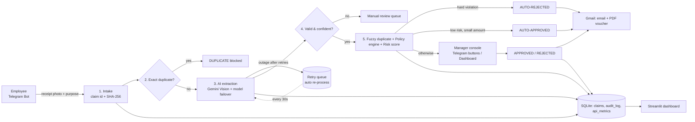

# 🧾 ClaimFlow AI

**Intelligent Travel & Expense Claim Automation: AI document understanding, a policy engine and human-in-the-loop approval**

An employee photographs a receipt and sends it to a Telegram bot. ClaimFlow AI reads it with Gemini Vision, checks for duplicates and fraud, applies the company expense policy, scores the risk, and then either auto-approves, auto-rejects or routes the claim to a manager's phone with Approve/Reject buttons. An email with a PDF voucher and full audit trail goes out at the end. A live dashboard tracks KPIs, logs and system health.

## Architecture



| Integrated platform | Role |
|---|---|
| **Telegram Bot API** | Employee intake channel and manager approval console (inline buttons) |
| **Google Gemini Vision** | Receipt OCR and understanding into schema-enforced JSON (3-model failover chain) |
| **SQLite** | Claims, immutable audit trail, API health metrics |
| **Gmail SMTP** | HTML decision email with PDF voucher attached |
| **Streamlit** | Ops dashboard: KPIs, claims explorer, review queue, live logs, system health |
| **GitHub Actions + Docker** | CI test suite on every push; containerised deployment |

## Exception handling

| # | Exception | Detection | Recovery |
|---|---|---|---|
| E1 | Unreadable / non-receipt image | AI confidence < 70%, `is_receipt=false`, schema validation fails | Manual review queue, employee asked to re-upload |
| E2 | Duplicate claim | SHA-256 image fingerprint (checked **before** the AI call); fuzzy match on vendor + amount + date or invoice no. | Exact duplicate blocked; similar claim flagged and sent to the manager |
| E3 | AI outage / rate limit | API exceptions (429/5xx/network) | Exponential backoff 2s→4s→8s with **model failover**; then parked in a **dead-letter retry queue** and re-processed automatically every 30s |
| E4 | Policy violation | YAML policy engine | Hard rule → auto-reject; soft rule → risk points → manager |
| + | Email failure | SMTP exceptions | 3 retries; claim decision never lost; `EMAIL_FAILED` written to audit |
| + | Any unexpected bug | Per-claim try/except | Only that claim is marked FAILED; the bot keeps running |
| + | Double approval click | Status check | Idempotent: a claim can be decided once only |

## Setup (Windows)

```bat
python -m venv .venv
.venv\Scripts\pip install -r requirements.txt
copy .env.example .env   & rem then fill in the keys
```

| Run | Command |
|---|---|
| Telegram bot (automation worker) | `run_bot.bat` or `python -m app.bot` |
| Dashboard | `run_dashboard.bat` or `streamlit run dashboard/dashboard.py` → http://localhost:8501 |
| Tests | `run_tests.bat` or `python -m pytest` |
| Demo receipts | `python tools/make_sample_receipts.py` (dates are relative to today, so re-run before recording) |
| Docker | `docker compose up --build` |

## Dashboard

`run_dashboard.bat` opens a multi-page operations console:

| Page | What it shows |
|---|---|
| **Command center** | KPIs (hands-free rate, processing time vs manual, money leakage prevented, staff hours saved), live pipeline flow, trends, risk distribution, rules triggered, activity feed |
| **Approval inbox** | Claims waiting for a human, with receipt, risk gauge, reasons and Approve/Reject (works like the Telegram buttons) |
| **Claims explorer** | Search and filter every claim, CSV export; click a row for the receipt, AI reading, policy checks, audit timeline and PDF voucher |
| **Live activity** | Plain-language business feed + colour-coded structured system logs (auto-refresh) |
| **System health** | Status of Telegram bot, Gemini, Gmail, database and retry queue; AI latency and per-model failover charts |
| **Expense policy** | Visual decision scale and a live policy editor; saving rewrites `policy.yaml` and the bot uses it instantly |

Optional demo history (46 synthetic claims over 14 days, run through the real policy engine):
`python tools/seed_demo_data.py --reset` (wipes existing claims first) or without `--reset` to append.

## Bot commands

`/start` (intro + optional email setup) · `/email` (set/change/`off`) · `/myclaims` · `/status CLM-2026-0001` (details + audit trail) · `/queue` (manager console) · `/policy` · `/stats` · `/chaos on|off` (simulate an AI outage) · `/reloadpolicy`

Send a photo, choose a purpose, and watch the 6 pipeline stages tick in real time. Adding a caption skips the purpose question.

## Demo receipts → expected outcome

| File | Scenario | Outcome |
|---|---|---|
| `01_meal_auto_approve.png` | Restaurant ₹850 | ✅ Auto-approved + email |
| `01_...` sent again | Same image | 🚫 **E2** exact duplicate blocked |
| `02_hotel_manager_approval.png` | Hotel ₹7,448 | 🟡 Manager card → Approve |
| `03_bar_alcohol_flagged.png` | Beer + whisky, over meals limit | 🟡 Risk 62 → manager rejects |
| `04_old_taxi_auto_reject.png` | Receipt 62 days old | ⛔ **E4** auto-rejected |
| `05_blurry_manual_review.png` | Heavily blurred | 🔍 **E1** manual review |
| `06_meal_duplicate_rephoto.png` | Different photo of the same bill as 01 | ⚠️ Suspected duplicate → manager |
| `07_not_a_receipt.png` | Landscape picture | 🔍 **E1** manual review |
| `08_cab_ride_auto_approve.png` | Cab ₹425 (send with `/chaos on`) | 🔁 **E3** queued → `/chaos off` → auto-processed |

## Project structure

```
app/
  bot.py            Telegram intake, live progress, manager console, retry worker
  pipeline.py       6-stage orchestrator, exception routing, manager decisions
  extractor.py      Gemini Vision, JSON schema, backoff + model failover, chaos mode
  duplicate.py      SHA-256 fingerprint + fuzzy duplicate detection
  policy_engine.py  YAML rules -> explainable flags
  risk.py           Risk score + routing decision
  notifier.py       PDF voucher (ReportLab) + Gmail HTML email
  db.py             SQLite: claims, audit_log, api_metrics
  logger.py         Structured logs (console, text, JSON lines) with claim correlation id
config/policy.yaml  Policy-as-code (limits, rules, risk weights, thresholds)
dashboard/          Streamlit operations dashboard
tests/              20 automated tests (TC01-TC10 + policy unit tests)
tools/              Demo receipt generator
```

## Notes

- **Free-tier Gemini** allows about 5 requests/min per model. The failover chain and retry queue absorb bursts, but in the demo, leave a few seconds between receipts.
- Single-account mode: leave `MANAGER_CHAT_ID` empty and the manager card arrives in the same chat.
- Logs: `logs/claimflow.log` (text) and `logs/claimflow.jsonl` (structured, shown live in the dashboard).
